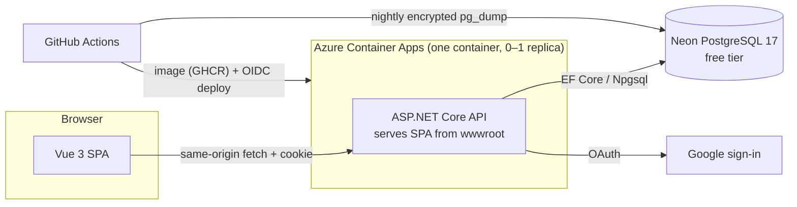
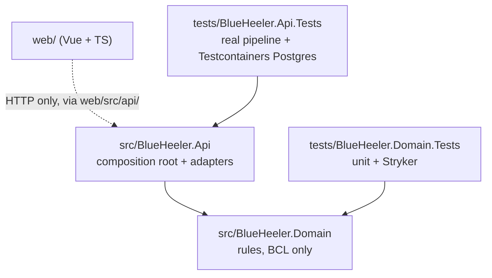
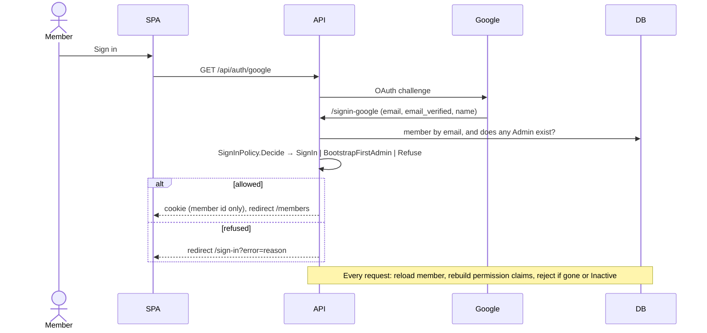

# Architecture

The reasoning behind the stack is in [ADR 0001](../adr/0001-stack-and-hosting.md); this
page explains how the parts fit now and where they're meant to grow.

## 1 Deployment

One image, one URL, one release unit: the SPA and API can't drift apart, and
same-origin hosting removes CORS and browser-held tokens. The cost is a cold start
after idle (Container Apps and Neon both scale to zero).

## 2 Projects and dependencies

- **Domain** holds the rules and references nothing but the BCL. An architecture test
  (`ArchitectureTests`) fails the build if that changes. This is Dependency Inversion
  at project level: infrastructure depends on rules, never the reverse, so rules are
  tested without a database or host.
- **Api** is the composition root and every adapter: EF Core (`Data/`), auth
  (`Auth/`), hosting concerns (`Hosting/`), and one folder per feature with its
  endpoints (`Members/`). It's one project because there is one deployable. Split out
  an infrastructure project only when a second host (a job, a kiosk API) needs the
  same adapters.
- **web** reaches the API only through `web/src/api/`, so a generated OpenAPI client
  can replace the hand-written one without touching pages.

## 3 Request pipeline

`Program.cs` order matters: forwarded headers (so OAuth redirects use `https` behind
the ingress) → problem-details exception handler → static SPA files →
authentication → authorization → endpoints → SPA fallback. Unknown `/api/*` paths
return 404 rather than the SPA. Options are validated at startup, before migrations
run, so bad configuration fails fast without touching the database.

## 4 Sign-in and authorization

Why it's shaped this way (details in the [PAS-F1-01 spec §2.2–2.3](../specs/PAS-F1-01-admin-signs-in.md)):

- **The roster decides access, matched by verified email.** Admins add members by
  email before they ever sign in, and magic links only know the email.
- **`SignInPolicy` is a pure function** returning a closed set of outcomes, so every
  branch is unit-tested and mutation-tested in the domain.
- **The cookie holds only the member id.** Permissions are rebuilt each request from
  the member's current role, so a role change or deactivation applies on the next
  request. One indexed lookup per request is nothing at this scale.
- **Endpoints require a `Permission`, never a role** (`.RequirePermission(...)`).
  `RolePermissions` maps roles to permission sets. A new role is one enum value and
  one table row; no endpoint changes (Open/Closed).
- **First admin** is bootstrapped from `Bootstrap:FirstAdminEmail` only while no Admin
  exists, so the setting can't be used to take over a running system.
- For `/api/*`, no cookie answers 401 and no permission 403 (no redirects), so the SPA
  decides where to send the user.

## 5 Data

- PostgreSQL through EF Core with snake_case naming. Enums are stored as their names so
  backups and the Neon console stay readable.
- Migrations live in `src/BlueHeeler.Api/Data/Migrations` and are applied at startup;
  EF Core's migration lock makes overlapping starts safe. Rolling back an image doesn't
  undo a migration, so write migrations that the previous release can live with.
- ASP.NET Core Data Protection keys are stored in the database, so cookies survive
  restarts and scale-to-zero.

## 6 Where it's meant to grow

These are the intended directions from the original plan. They're not built yet; add
each when the first feature needs it, not before.

| Concern | Intent | Trigger |
|---|---|---|
| Bounded contexts | Membership, Scheduling, later Timekeeping, as namespaces in the one Domain project, sharing only a member id; guarded by an architecture test | Shifts arrive (PAS-F1-04) |
| Double-booking | Domain check plus a Postgres exclusion constraint on time ranges (Npgsql range types) | Sign-up (PAS-F1-05) |
| Last place race | Database-level guarantee (constraint or row lock), not only an in-memory check | Sign-up (PAS-F1-05) |
| Time | Store instants in UTC; show in the shelter's zone; consider NodaTime for overnight/DST maths | Shifts arrive |
| Recurring shifts | Templates (RFC 5545 RRULE) materialised for a rolling window, so editing one instance doesn't rewrite history | Phase 2 |
| Domain events | Raised in-process between contexts (e.g. member made Inactive → cancel future sign-ups) | First cross-context rule |
| Integrations | Port owned by the core, named for the capability, adapter per vendor; transactional outbox so a vendor outage can't roll back a sign-up | First integration (email reminders or mailing lists) |
| API contract | OpenAPI document → TS client via `openapi-typescript`, so a breaking API change fails CI | When hand-written client types start drifting |
| State-changing endpoints | Antiforgery protection with the cookie | First POST/PUT (PAS-F1-02) |
| Sensitive fields | Encrypt emergency contacts with Data Protection; export-and-delete path per member | Phase 2–3 |
| Observability | OpenTelemetry to Application Insights free tier | Before go-live |

Deliberately not planned: microservices, a separate identity provider, Key Vault (until
secrets multiply), a component library for the SPA (until the UI needs one).
