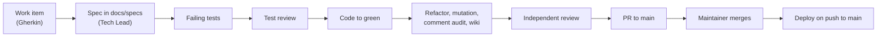

# Development

## 1 Prerequisites and running locally

.NET 10 SDK (pinned in `global.json`), Node 22 (`web/.nvmrc`), Docker. The steps to run
the app against a local PostgreSQL with a dev Google client are in the
[README](../../README.md#run-locally). Secrets go in `dotnet user-secrets`, never in
`appsettings*.json`.

## 2 The gate

Every PR must pass these, and CI runs the same ones (`.github/workflows/ci.yml`):

```bash
dotnet build -warnaserror           # analyzers are part of the build
dotnet format --verify-no-changes
dotnet test                         # API tests start PostgreSQL via Testcontainers (needs Docker)
(cd web && npm ci && npm test && npm run build)
```

Domain changes also need mutation testing at ≥ 80%:

```bash
cd tests/BlueHeeler.Domain.Tests && dotnet tool restore && dotnet stryker
```

Why mutation testing on the domain only: that's where the rules are, and a test that
passes whatever the rule says is worse than none. Infrastructure is covered by API
tests against a real database instead.

## 3 Tests

| Project | Style | Why |
|---|---|---|
| `tests/BlueHeeler.Domain.Tests` | Fast unit tests of pure rules, plus `ArchitectureTests` | Rules are pure functions; mutation testing keeps the tests honest |
| `tests/BlueHeeler.Api.Tests` | Real HTTP pipeline (`WebApplicationFactory`) on real PostgreSQL (Testcontainers); Google faked by `FakeGoogle` | Auth, permissions and SQL behaviour (constraints, races) only show up for real |
| `web/src/**/*.spec.ts` | Vitest + Vue Test Utils | Router guards and page behaviour |

Tests are named for behaviour, mirror the Gherkin of the item, and are written first
(red, then green, then refactor).

## 4 Adding things

### 4.1 An endpoint

1. Add a `Permission` value in `src/BlueHeeler.Domain/Access/Permission.cs`, and grant
   it to roles in `RolePermissions`. Never check a role name in an endpoint.
2. Map the endpoint in the feature's folder under `src/BlueHeeler.Api/<Feature>/`
   with `.RequirePermission(Permission.X)`, and call its `Map…Endpoints` from
   `Program.cs`.
3. Put the rule in the domain as a pure function or aggregate method; the endpoint
   loads, calls the domain and saves.
4. Return response records (e.g. `MemberResponse`), never entities.
5. State-changing endpoints need antiforgery protection (not yet wired; the first one,
   PAS-F1-02, adds it).

### 4.2 A role

One `Role` value and one `RolePermissions` row. A test fails if a role has no row.

### 4.3 A database change

```bash
dotnet tool restore
dotnet ef migrations add <Name> --project src/BlueHeeler.Api
```

Migrations run at startup, and a rolled-back image doesn't undo one, so keep them
compatible with the previous release (add before you remove).

### 4.4 An SPA call

Add a typed function in `web/src/api/`. Pages never call `fetch` directly. A 401
means "send to sign-in"; a 403 means "show no access".

## 5 Coding standards

The project follows the devflow `engineering-standards`, `dotnet-standards` and
`azure-standards` skills (named in `CLAUDE.md`). The short version:

- Domain has no infrastructure references. Rules are pure and tested without I/O.
- Value objects (records) for validated values, e.g. `EmailAddress`.
- Expected outcomes are values (e.g. `SignInDecision`); exceptions are for bugs and
  broken invariants.
- `CancellationToken` through every async call; options bound and validated at startup.
- Comments say why, not what; no history or ticket references in code.
- Warnings are errors. Fix the cause or suppress with a stated justification.

## 6 Workflow



- One work item per branch and PR, into `main`. Card review is required: the
  maintainer reviews and merges; automation never merges.
- Each item gets a spec in `docs/specs/PAS-F<n>-<NN>-<slug>.md` before code: behaviour
  (the Gherkin), design, out of scope, footprint, test map, risks.
- A decision that constrains future work gets an ADR in `docs/adr/` (next number,
  status, context, decision, consequences).
- The PR updates this wiki where it changes a structure, pattern or convention, and
  ticks the item in [roadmap.md §4](roadmap.md#4-phase-1-work-items).
- Commits follow Conventional Commits (`feat(members): …`, `docs(wiki): …`).
- AI sessions with the devflow plugin drive this loop with `/devflow:orchestrate`;
  planning uses `devflow:business-analyst` and `devflow:tech-lead`.
