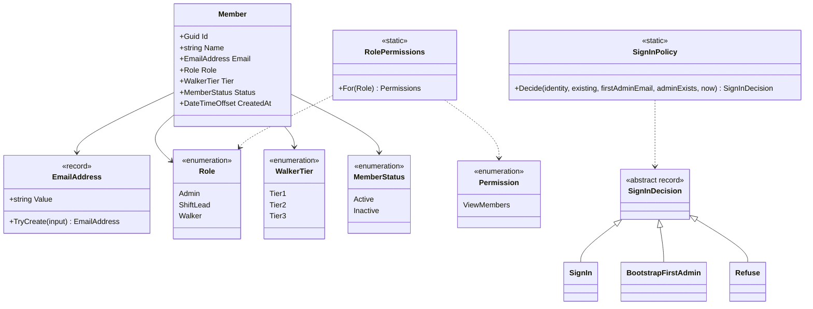

# Domain

## 1 Glossary

Use these words in code, tests, specs and UI so they mean one thing everywhere.

| Term | Meaning |
|---|---|
| Member | A person on the volunteer roster. Only members can sign in. |
| Roster | All members, Active and Inactive. |
| Status | `Active` (can sign in and sign up) or `Inactive` (kept for records, can't sign in). |
| Role | A named set of permissions a member holds: `Admin`, `ShiftLead`, `Walker`. |
| Admin | Volunteer coordinator. Manages members, sees sensitive records. |
| Shift Lead | Runs a shift: sees the roster, asks for more people, marks attendance. |
| Walker | A volunteer who walks dogs and signs up for shifts. |
| Tier | A walker's training level, 1–3. Doesn't limit sign-up. |
| Permission | One action the app guards (e.g. `ViewMembers`). Endpoints check permissions, never roles. |
| Shift | A dated time slot with a capacity and a Tier 2 target. |
| Sign-up | A member's place on a shift. Confirmed at once. |
| Capacity | Most sign-ups a shift takes. |
| Tier 2 target | How many Tier 2+ walkers a shift should have. |
| Understaffed | A shift with fewer Tier 2+ sign-ups than its target. Derived, never stored. |
| Attendance | A lead's record that a sign-up attended or was a no-show, with an optional note and actual hours. |
| Magic link | A single-use, expiring sign-in link sent by email. |
| First admin | The member created from `Bootstrap:FirstAdminEmail` on first sign-in while no Admin exists. |

## 2 The model today

All in `src/BlueHeeler.Domain`.

| Type | Folder | Invariants |
|---|---|---|
| `Member` | `Members/` | Non-empty id; name not blank, ≤ 200 after trimming; email required; `Tier` is null for members who don't walk |
| `EmailAddress` | `Members/` | Trimmed and lower-cased, one `@` between non-empty parts, no whitespace, ≤ 254 chars; `TryCreate` returns null otherwise. Deliberately loose: the identity provider or magic link proves deliverability |
| `RolePermissions` | `Access/` | Every `Role` has a row; a missing row throws, so a new role can't silently grant nothing |
| `SignInPolicy` | `Access/` | Unverified email → refuse; existing member → sign in only if Active; unknown email → bootstrap only if it is the first-admin email and no Admin exists; otherwise refuse |

Current role grants: `Admin` → `ViewMembers`; `ShiftLead` and `Walker` → none yet.
Each new endpoint adds its `Permission` and the rows that grant it.

## 3 The model planned

From the approved plan; shapes are indicative until each item's spec fixes them.

| Context | Aggregate | Holds | Key rules |
|---|---|---|---|
| Membership | `Member` | Profile, status, role, tier; later emergency contact, training records, signed documents, conduct notes | Only Active members sign in or sign up |
| Scheduling | `Shift` | Time range (UTC), capacity, Tier 2 target, sign-ups; later a lead slot and recurrence template | Sign-ups ≤ capacity; a member can't hold overlapping sign-ups (domain check + exclusion constraint); understaffed = Tier 2+ sign-ups < target |
| Attendance (Phase 2) | per sign-up | Attended / no-show, note, actual hours | Hours = actual hours if given, else shift length |
| Timekeeping (Phase 4) | `TimeEntry` | Clock-in/out instants, source | One open entry per member; corrections are new entries, never edits |

Contexts share only the member id, so each can change without breaking the others.
