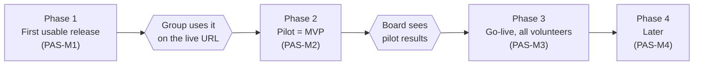

# Roadmap

## 1 Phases and gates



Each phase must work end to end on the live URL before the next starts. Nothing in a
later phase is dropped, only deferred. Phases 2 to 4 stay coarse until real use shows
what to change: the pilot will reshape them more than any upfront spec.

| Phase | Outcome | Exit |
|---|---|---|
| 1 First usable release | The maintainer's group signs up for real shifts from their phones; admins manage members and see which shifts are short of Tier 2 walkers | Items 1–7 accepted on the live URL; the group entered; a week of real shifts posted; $0 running cost |
| 2 Pilot (MVP) | The group runs on the app for real: recurring shifts, attendance, reminders, training and waiver records, reports | Results good enough to take to the board |
| 3 Go-live | All volunteers, with the sensitive records and admin tooling a full roster needs | Board backing |
| 4 Later | Integrations and nice-to-haves | Driven by need |

## 2 Features by phase

"First cut" is the smallest version that proves the feature end to end.

| Feature | Phase | First cut | Deferred part |
|---|---|---|---|
| Shift scheduling | 1 | One-off shift with capacity; sign up, cancel, "my shifts" | Weekly recurrence (2), drop cutoff (3), waitlist and swaps (4) |
| Roles and tiers | 1 | Admin sets role and tier by hand | Tier from training records (2) |
| Role-based access | 1 | Walkers sign up; admins manage | Per-record-type permissions (3) |
| Member management | 1 | Admin adds a member: name, email, role, tier, Active/Inactive | Spreadsheet import, onboarding pipeline (3) |
| Tier 2 coverage target | 1 | Shift flagged understaffed below its target | |
| Lead requests more people | 2 | Lead flags a shift short; eligible walkers get an email | SMS, in-app alerts (4) |
| Attendance | 2 | Lead marks attended or no-show, optional note and actual hours | No-show pattern report (3) |
| Coverage report | 2 | Filled vs open per shift by week, understaffed marked | Charts, export (3) |
| Membership report | 2 | Active members by role and tier, last shift date | Hours totals for grants (3) |
| Training records | 2 | Course and date per volunteer | Expiry and renewal reminders (3) |
| Signed documents and waivers | 2 | Type, version and date, entered by an admin | Scans, e-signature (4) |
| Email notices | 2 | Reminders via a transactional email free tier | Mailing-list sync, SMS (4) |
| Mass cancel and notify | 2 | Cancel a day of shifts in one action | |
| Emergency contact | 2 | On the member profile | |
| Disciplinary records | 3 | Dated note with outcome, admins only | |
| Audit log | 3 | Who changed tiers, attendance, conduct notes | |
| Privacy and retention rules | 3 | Who sees what, how long it's kept after someone leaves | |
| iCal feed | 3 | Per-member secret URL | |
| Clock-in / kiosk | 4 | Only if lead-marked attendance proves too coarse | |
| PetPoint link | 4 | Needs a spike once the shelter requests an API key | |

Disciplinary records wait for Phase 3 because they are the most sensitive data and the
pilot doesn't need them. SMS waits for a budget: it's billed per message and needs US
number registration, while email is free at this size.

## 3 Naming

Per `CLAUDE.md`: line `PAS`, features `PAS-F<n>`, work items (cards) `PAS-F<n>-<NN>`,
milestones `PAS-M<n>` where `n` is the phase. Phase 1's feature is `PAS-F1`.

## 4 Phase 1 work items

Approved with Gherkin acceptance criteria. Items 1 and 2 come first because every later
item needs a signed-in member; 3, 6 and 7 are independent of each other. Each item gets
a spec in [`docs/specs/`](../specs/) before code.

| Card | Item | Depends on | Status |
|---|---|---|---|
| PAS-F1-01 | Admin signs in with Google and sees the member list | none | Done ([spec](../specs/PAS-F1-01-admin-signs-in.md)) |
| PAS-F1-02 | Admin adds and edits members, who can then sign in | 01 | Next |
| PAS-F1-03 | Member signs in with an emailed link | 02 | |
| PAS-F1-04 | Admin creates a shift that members can see | 02 | |
| PAS-F1-05 | Walker signs up for a shift and sees it under My shifts | 04 | |
| PAS-F1-06 | Walker cancels a sign-up | 05 | |
| PAS-F1-07 | Understaffed shifts are flagged | 05 | |

Update the status column in the PR that completes an item.

### 4.1 Acceptance criteria not yet in a spec

Copied from the approved plan so they survive outside it. When an item's spec is
written, it becomes the source and the block here is deleted.

```gherkin
# PAS-F1-02
Scenario: A new member signs in
  Given an admin adds "Sam" with email "sam@example.org", role Walker, Tier 1
  When Sam signs in with Google as "sam@example.org"
  Then Sam is signed in as an Active Walker, Tier 1
Scenario: An unknown email is turned away
  Given no member has the email "stranger@example.org"
  When someone signs in with Google as "stranger@example.org"
  Then they are not signed in
  And they are told to contact the volunteer coordinator
Scenario: An inactive member is turned away
  Given an admin sets Sam to Inactive
  When Sam signs in
  Then Sam is not signed in
Scenario: Only admins manage members
  Given Sam is a Walker
  When Sam opens the member list
  Then Sam is refused
Scenario Outline: An admin changes a member's role or tier
  Given Sam is a Walker, Tier 1
  When an admin sets Sam's <field> to <value>
  Then the member list shows Sam with <field> <value>
  Examples:
    | field | value      |
    | role  | Shift Lead |
    | tier  | 2          |

# PAS-F1-03
Scenario: A member signs in by email link
  Given Sam is an Active member with email "sam@example.org"
  When Sam asks for a sign-in link for "sam@example.org"
  And opens the link from that email
  Then Sam is signed in
Scenario: A used or expired link fails
  Given Sam has a sign-in link that was already used or has expired
  When Sam opens it
  Then Sam is not signed in and can ask for a new link
Scenario: An unknown email gets the same answer
  When someone asks for a link for "stranger@example.org"
  Then they see the same "check your email" message as a member
  And no email is sent

# PAS-F1-04
Scenario: A created shift appears for walkers
  Given an admin creates a shift on Sat 21 Nov, 9:00 to 11:00, capacity 4, Tier 2 target 1
  When Sam, a Walker, views upcoming shifts
  Then Sam sees that shift with 4 open places
Scenario: Only admins create shifts
  When Sam, a Walker, tries to create a shift
  Then Sam is refused
Scenario: A shift that has ended is not listed
  Given a shift that ended yesterday
  When Sam views upcoming shifts
  Then that shift is not shown

# PAS-F1-05
Scenario: Signing up takes a place
  Given a shift with capacity 4 and 1 sign-up
  When Sam signs up
  Then Sam sees the shift under My shifts
  And the shift shows 2 open places
Scenario: A full shift refuses sign-up
  Given a shift with capacity 2 and 2 sign-ups
  When Sam tries to sign up
  Then Sam is told the shift is full and is not signed up
Scenario: Overlapping shifts are refused
  Given Sam is signed up for Sat 9:00 to 11:00
  When Sam tries to sign up for Sat 10:00 to 12:00
  Then Sam is told it overlaps and is not signed up
Scenario: The last place goes to one person only
  Given a shift with 1 open place
  When Sam and Alex sign up at the same moment
  Then exactly one of them is signed up

# PAS-F1-06
Scenario: Cancelling frees the place
  Given Sam is signed up for a shift with 0 open places
  When Sam cancels
  Then the shift is gone from Sam's My shifts
  And the shift shows 1 open place

# PAS-F1-07
Scenario Outline: Flag by Tier 2+ walkers signed up
  Given a shift with a Tier 2 target of <target>
  And <count> walkers of Tier 2 or higher are signed up
  When an admin or Shift Lead views upcoming shifts
  Then the shift <flag> as understaffed
  Examples:
    | target | count | flag         |
    | 1      | 0     | is shown     |
    | 1      | 1     | is not shown |
    | 2      | 1     | is shown     |
Scenario: Tier 1 sign-ups do not count toward the target
  Given a shift with a Tier 2 target of 1 and three Tier 1 walkers signed up
  Then the shift is shown as understaffed
```

Phase 1 manual check: a walker from the group signs in, signs up and cancels on their
own phone without help.

### 4.2 Risks to watch

- The last place on a shift (item 5) needs a database-level guarantee, not only a
  check in code.
- The free tier's cold start after idle is felt by real users.
- Real member data from day one: a restore drill must pass before anyone but the admin
  is entered ([ADR 0002](../adr/0002-backups.md)).
